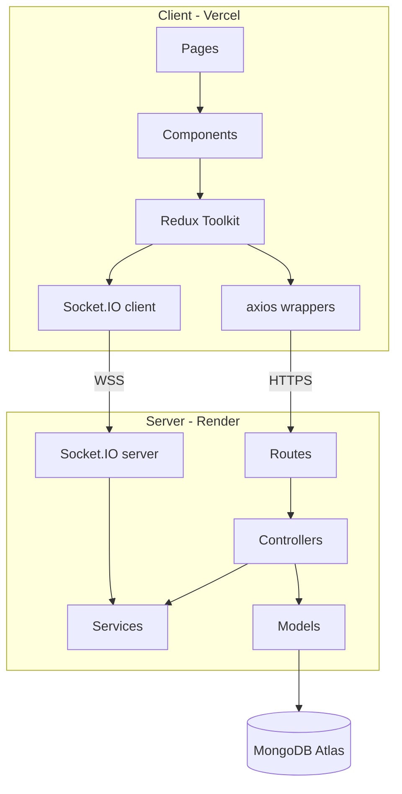

# Apres — Architecture

## High-Level Diagram
(Paste the ASCII or a Mermaid diagram here)

## Architectural Decisions

### D1: Monorepo with client/ and server/
Simplifies README, devlog, and CI. Vercel points at `client/`, Render at `server/`.
Single source of truth for the API contract.

### D2: Layered backend (routes → controllers → services → models)
Controllers stay thin. Business logic (tip math, conflict detection) lives in
`services/` as pure functions, making it unit-testable without HTTP or DB.

### D3: RBAC as middleware
One `requireRole([...])` middleware instead of scattered permission checks.
Testable in isolation. Applied at the route layer.

### D4: Redux Toolkit for server state; local state for UI state
Dropdown open/closed stays in component state. Fetched data lives in Redux
slices. Prevents the classic "everything in Redux" trap.

### D5: JWT in Authorization header (not httpOnly cookie)
Simpler for a portfolio demo. Trade-off: slightly more XSS-exposed than
httpOnly cookies. Mitigations: short expiry, no token in localStorage beyond
session, CORS locked to the Vercel origin. Documented in README as a known
trade-off.

### D6: Socket.IO rooms per venue and per shift
Not per user. Matches the domain and keeps event routing simple.

## Data Model
(Paste the schema sketches from earlier — User, Venue, Shift, AvailabilityWindow,
SwapRequest, TipPoolRule, TipDistribution, Message)

## API Surface
See `docs/api.md`.

